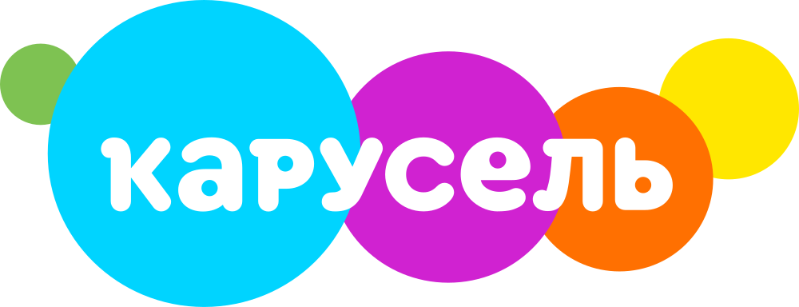
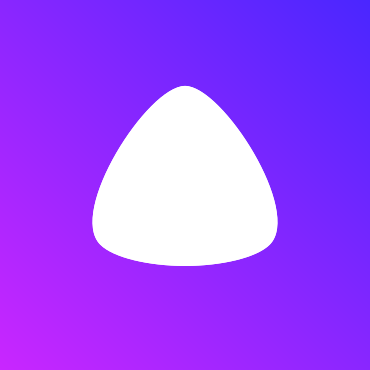
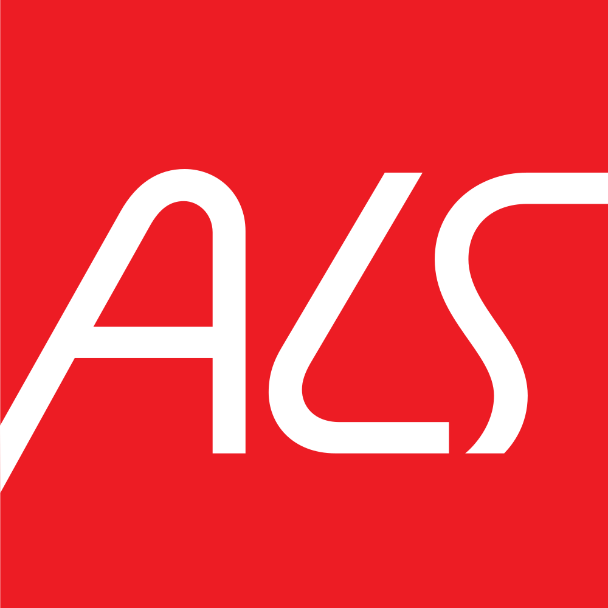

# Russian Brand Logos

**SVG logos of Russian brands · SVG‑логотипы российских брендов**

  

[English](#english) · [Русский](#русский) · [Gallery · Галерея](#gallery) · [Topics](#topics)

## English

A small open set of SVG logos of brands founded in Russia: 127 logos in 28 categories. The files are mirrored from the [Trace Logos](https://trace-logos.ru/logos/?utm_source=github&utm_medium=readme&utm_campaign=russian-brand-logos) catalog and refreshed automatically once a day. Every preview links to the brand's page in the catalog.

Files live at `logos/<category>/<slug>.svg`; the path matches the brand's catalog address.

### What the full catalog has

The [catalog](https://trace-logos.ru/logos/?utm_source=github&utm_medium=readme&utm_campaign=russian-brand-logos) has 804 logos in 44 categories, including international brands. On top of the SVG files kept here it offers:

- PNG files alongside SVG;
- logo variants: horizontal lockups, English lettering, earlier versions;
- search in Russian and English, with keyboard layout correction;
- a color editor for SVG logos;
- Figma-ready SVG export and copying to the clipboard;
- downloading a selection as a ZIP archive.

### Categories

| Category | Logos |
|---|---:|
| [Marketplaces & Retail](logos/market/README.md) | 26 |
| [Messengers & Social](logos/social/README.md) | 3 |
| [Banks](logos/bank/README.md) | 15 |
| [Payments & Cards](logos/pay/README.md) | 5 |
| [Video & Streaming](logos/video/README.md) | 7 |
| [TV Channels](logos/tv/README.md) | 6 |
| [AI & Neural Networks](logos/ai/README.md) | 3 |
| [Maps & Navigation](logos/map/README.md) | 1 |
| [Search & Browsers](logos/search/README.md) | 1 |
| [Music & Media](logos/music/README.md) | 3 |
| [Stores & Subscriptions](logos/store/README.md) | 3 |
| [Food & Restaurants](logos/food/README.md) | 4 |
| [Documents & EDI](logos/docs/README.md) | 1 |
| [Delivery & Taxi](logos/delivery/README.md) | 6 |
| [Email](logos/mail/README.md) | 1 |
| [Warehouse, ERP & CRM](logos/crm/README.md) | 3 |
| [Education](logos/education/README.md) | 4 |
| [B2B & Enterprise](logos/b2b/README.md) | 6 |
| [Travel](logos/travel/README.md) | 4 |
| [Cloud & Storage](logos/cloud/README.md) | 3 |
| [Developers & Real Estate](logos/developers/README.md) | 6 |
| [Telecom & Internet](logos/telecom/README.md) | 2 |
| [Websites & CMS](logos/web/README.md) | 2 |
| [Insurance](logos/insurance/README.md) | 5 |
| [Health](logos/health/README.md) | 1 |
| [Gas Stations](logos/gas-stations/README.md) | 4 |
| [Automotive](logos/car/README.md) | 1 |
| [Bookmakers & Lotteries](logos/bookmakers/README.md) | 1 |

### License and trademarks

This is an independent library, not affiliated with or endorsed by the brand owners. Logos and trademarks belong to their respective owners. The MIT license covers only the code in this repository (`scripts/`, workflows), not the logos. Rights holders can request removal through an [issue](../../issues/new?template=removal-request.yml). Details: [NOTICE.md](NOTICE.md).

## Русский

Небольшой открытый набор SVG‑логотипов брендов, основанных в России: 127 логотипов в 28 категориях. Файлы берутся из каталога [Trace Logos](https://trace-logos.ru/logos/?utm_source=github&utm_medium=readme&utm_campaign=russian-brand-logos) и обновляются автоматически раз в сутки. Каждое превью ведёт на страницу бренда в каталоге.

Файлы лежат в `logos/<категория>/<slug>.svg`; путь совпадает с адресом бренда в каталоге.

### Что есть в полном каталоге

В [каталоге](https://trace-logos.ru/logos/?utm_source=github&utm_medium=readme&utm_campaign=russian-brand-logos) 804 логотипа в 44 категориях, включая международные бренды. Помимо SVG, которые лежат здесь, там есть:

- PNG‑файлы рядом с SVG;
- варианты логотипа: горизонтальные, с латиницей, прежние версии;
- поиск на русском и английском с исправлением раскладки;
- редактор цветов для SVG‑логотипов;
- экспорт SVG, готового для Figma, и копирование в буфер обмена;
- скачивание подборки ZIP‑архивом.

### Категории

| Категория | Логотипов |
|---|---:|
| [Маркетплейсы и ритейл](logos/market/README.md) | 26 |
| [Мессенджеры и соцсети](logos/social/README.md) | 3 |
| [Банки](logos/bank/README.md) | 15 |
| [Платежи и карты](logos/pay/README.md) | 5 |
| [Видео и стриминг](logos/video/README.md) | 7 |
| [Телеканалы](logos/tv/README.md) | 6 |
| [Нейросети](logos/ai/README.md) | 3 |
| [Карты и навигация](logos/map/README.md) | 1 |
| [Поиск и браузеры](logos/search/README.md) | 1 |
| [Музыка и медиа](logos/music/README.md) | 3 |
| [Сторы и подписки](logos/store/README.md) | 3 |
| [Еда и рестораны](logos/food/README.md) | 4 |
| [Документы и ЭДО](logos/docs/README.md) | 1 |
| [Доставка и такси](logos/delivery/README.md) | 6 |
| [Почта](logos/mail/README.md) | 1 |
| [Склад, ERP и CRM](logos/crm/README.md) | 3 |
| [Образование](logos/education/README.md) | 4 |
| [B2B и корпоративные сервисы](logos/b2b/README.md) | 6 |
| [Путешествия](logos/travel/README.md) | 4 |
| [Облака и хранилища](logos/cloud/README.md) | 3 |
| [Девелоперы и недвижимость](logos/developers/README.md) | 6 |
| [Связь и интернет](logos/telecom/README.md) | 2 |
| [Сайты и CMS](logos/web/README.md) | 2 |
| [Страхование](logos/insurance/README.md) | 5 |
| [Здоровье](logos/health/README.md) | 1 |
| [Заправки](logos/gas-stations/README.md) | 4 |
| [Автомобили](logos/car/README.md) | 1 |
| [Букмекеры и лотереи](logos/bookmakers/README.md) | 1 |

### Лицензия и товарные знаки

Это независимая библиотека, не связанная с владельцами брендов и не одобренная ими. Логотипы и товарные знаки принадлежат их владельцам. Лицензия MIT распространяется только на код репозитория (`scripts/`, workflows), но не на логотипы. Правообладатель может запросить удаление через [issue](../../issues/new?template=removal-request.yml). Подробнее: [NOTICE.md](NOTICE.md).

## Gallery · Галерея

The first 12 logos of each category · Первые 12 логотипов каждой категории.

### Marketplaces & Retail · Маркетплейсы и ритейл

<table>
<tr>
<td align="center" width="120"><a href="https://trace-logos.ru/logos/market/ozon/?utm_source=github&amp;utm_medium=readme&amp;utm_campaign=russian-brand-logos"> Ozon</a></td>
<td align="center" width="120"><a href="https://trace-logos.ru/logos/market/krasnoeibeloe/?utm_source=github&amp;utm_medium=readme&amp;utm_campaign=russian-brand-logos"> Красное&amp;Белое</a></td>
<td align="center" width="120"><a href="https://trace-logos.ru/logos/market/wildberries/?utm_source=github&amp;utm_medium=readme&amp;utm_campaign=russian-brand-logos"> Wildberries</a></td>
<td align="center" width="120"><a href="https://trace-logos.ru/logos/market/yandexmarket/?utm_source=github&amp;utm_medium=readme&amp;utm_campaign=russian-brand-logos"> Яндекс Маркет</a></td>
<td align="center" width="120"><a href="https://trace-logos.ru/logos/market/avito/?utm_source=github&amp;utm_medium=readme&amp;utm_campaign=russian-brand-logos"> Авито</a></td>
<td align="center" width="120"><a href="https://trace-logos.ru/logos/market/goldenapple/?utm_source=github&amp;utm_medium=readme&amp;utm_campaign=russian-brand-logos"> Золотое яблоко</a></td>
</tr>
<tr>
<td align="center" width="120"><a href="https://trace-logos.ru/logos/market/dns/?utm_source=github&amp;utm_medium=readme&amp;utm_campaign=russian-brand-logos"> DNS</a></td>
<td align="center" width="120"><a href="https://trace-logos.ru/logos/market/pyaterochka/?utm_source=github&amp;utm_medium=readme&amp;utm_campaign=russian-brand-logos"> Пятёрочка</a></td>
<td align="center" width="120"><a href="https://trace-logos.ru/logos/market/mvideo/?utm_source=github&amp;utm_medium=readme&amp;utm_campaign=russian-brand-logos"> М.Видео</a></td>
<td align="center" width="120"><a href="https://trace-logos.ru/logos/market/sportmaster/?utm_source=github&amp;utm_medium=readme&amp;utm_campaign=russian-brand-logos"> Спортмастер</a></td>
<td align="center" width="120"><a href="https://trace-logos.ru/logos/market/letual/?utm_source=github&amp;utm_medium=readme&amp;utm_campaign=russian-brand-logos"> Л'Этуаль</a></td>
<td align="center" width="120"><a href="https://trace-logos.ru/logos/market/auto-ru/?utm_source=github&amp;utm_medium=readme&amp;utm_campaign=russian-brand-logos"> Авто ру</a></td>
</tr>
</table>

[All 26 → · Все 26 →](logos/market/README.md)

### Messengers & Social · Мессенджеры и соцсети

<table>
<tr>
<td align="center" width="120"><a href="https://trace-logos.ru/logos/social/max/?utm_source=github&amp;utm_medium=readme&amp;utm_campaign=russian-brand-logos"> Max</a></td>
<td align="center" width="120"><a href="https://trace-logos.ru/logos/social/vk/?utm_source=github&amp;utm_medium=readme&amp;utm_campaign=russian-brand-logos"> ВКонтакте</a></td>
<td align="center" width="120"><a href="https://trace-logos.ru/logos/social/odnoklassniki/?utm_source=github&amp;utm_medium=readme&amp;utm_campaign=russian-brand-logos"> Одноклассники</a></td>
</tr>
</table>

[All 3 → · Все 3 →](logos/social/README.md)

### Banks · Банки

<table>
<tr>
<td align="center" width="120"><a href="https://trace-logos.ru/logos/bank/domrfbank/?utm_source=github&amp;utm_medium=readme&amp;utm_campaign=russian-brand-logos"> Банк ДОМ.РФ</a></td>
<td align="center" width="120"><a href="https://trace-logos.ru/logos/bank/sber/?utm_source=github&amp;utm_medium=readme&amp;utm_campaign=russian-brand-logos"> Сбер</a></td>
<td align="center" width="120"><a href="https://trace-logos.ru/logos/bank/tbank/?utm_source=github&amp;utm_medium=readme&amp;utm_campaign=russian-brand-logos"> Т-Банк</a></td>
<td align="center" width="120"><a href="https://trace-logos.ru/logos/bank/mts/?utm_source=github&amp;utm_medium=readme&amp;utm_campaign=russian-brand-logos"> МТС Банк</a></td>
<td align="center" width="120"><a href="https://trace-logos.ru/logos/bank/alfa/?utm_source=github&amp;utm_medium=readme&amp;utm_campaign=russian-brand-logos"> Альфа Банк</a></td>
<td align="center" width="120"><a href="https://trace-logos.ru/logos/bank/vtb/?utm_source=github&amp;utm_medium=readme&amp;utm_campaign=russian-brand-logos"> ВТБ</a></td>
</tr>
<tr>
<td align="center" width="120"><a href="https://trace-logos.ru/logos/bank/otkritie/?utm_source=github&amp;utm_medium=readme&amp;utm_campaign=russian-brand-logos"> Открытие</a></td>
<td align="center" width="120"><a href="https://trace-logos.ru/logos/bank/uralsib/?utm_source=github&amp;utm_medium=readme&amp;utm_campaign=russian-brand-logos"> УралСиб</a></td>
<td align="center" width="120"><a href="https://trace-logos.ru/logos/bank/sovkom/?utm_source=github&amp;utm_medium=readme&amp;utm_campaign=russian-brand-logos"> Совкомбанк</a></td>
<td align="center" width="120"><a href="https://trace-logos.ru/logos/bank/ozonbank/?utm_source=github&amp;utm_medium=readme&amp;utm_campaign=russian-brand-logos"> Ozon Банк</a></td>
<td align="center" width="120"><a href="https://trace-logos.ru/logos/bank/renaissance/?utm_source=github&amp;utm_medium=readme&amp;utm_campaign=russian-brand-logos"> Ренессанс</a></td>
<td align="center" width="120"><a href="https://trace-logos.ru/logos/bank/loko/?utm_source=github&amp;utm_medium=readme&amp;utm_campaign=russian-brand-logos"> Локо Банк</a></td>
</tr>
</table>

[All 15 → · Все 15 →](logos/bank/README.md)

### Payments & Cards · Платежи и карты

<table>
<tr>
<td align="center" width="120"><a href="https://trace-logos.ru/logos/pay/sbp/?utm_source=github&amp;utm_medium=readme&amp;utm_campaign=russian-brand-logos"> СБП</a></td>
<td align="center" width="120"><a href="https://trace-logos.ru/logos/pay/digitalruble/?utm_source=github&amp;utm_medium=readme&amp;utm_campaign=russian-brand-logos"> Цифровой рубль</a></td>
<td align="center" width="120"><a href="https://trace-logos.ru/logos/pay/mir/?utm_source=github&amp;utm_medium=readme&amp;utm_campaign=russian-brand-logos"> Мир Pay</a></td>
<td align="center" width="120"><a href="https://trace-logos.ru/logos/pay/yumoney/?utm_source=github&amp;utm_medium=readme&amp;utm_campaign=russian-brand-logos"> ЮMoney</a></td>
<td align="center" width="120"><a href="https://trace-logos.ru/logos/pay/yukassa/?utm_source=github&amp;utm_medium=readme&amp;utm_campaign=russian-brand-logos"> ЮКасса</a></td>
</tr>
</table>

[All 5 → · Все 5 →](logos/pay/README.md)

### Video & Streaming · Видео и стриминг

<table>
<tr>
<td align="center" width="120"><a href="https://trace-logos.ru/logos/media/vkvideo/?utm_source=github&amp;utm_medium=readme&amp;utm_campaign=russian-brand-logos"> VK Видео</a></td>
<td align="center" width="120"><a href="https://trace-logos.ru/logos/media/rutube/?utm_source=github&amp;utm_medium=readme&amp;utm_campaign=russian-brand-logos"> Rutube</a></td>
<td align="center" width="120"><a href="https://trace-logos.ru/logos/media/kinopoisk/?utm_source=github&amp;utm_medium=readme&amp;utm_campaign=russian-brand-logos"> Кинопоиск</a></td>
<td align="center" width="120"><a href="https://trace-logos.ru/logos/media/vkplay/?utm_source=github&amp;utm_medium=readme&amp;utm_campaign=russian-brand-logos"> VK Play</a></td>
<td align="center" width="120"><a href="https://trace-logos.ru/logos/media/kion/?utm_source=github&amp;utm_medium=readme&amp;utm_campaign=russian-brand-logos"> КИОН</a></td>
<td align="center" width="120"><a href="https://trace-logos.ru/logos/media/okko/?utm_source=github&amp;utm_medium=readme&amp;utm_campaign=russian-brand-logos"> Okko</a></td>
</tr>
<tr>
<td align="center" width="120"><a href="https://trace-logos.ru/logos/media/wink/?utm_source=github&amp;utm_medium=readme&amp;utm_campaign=russian-brand-logos"> WINK</a></td>
</tr>
</table>

[All 7 → · Все 7 →](logos/video/README.md)

### TV Channels · Телеканалы

<table>
<tr>
<td align="center" width="120"><a href="https://trace-logos.ru/logos/tv/tnt/?utm_source=github&amp;utm_medium=readme&amp;utm_campaign=russian-brand-logos"> ТНТ</a></td>
<td align="center" width="120"><a href="https://trace-logos.ru/logos/tv/sts/?utm_source=github&amp;utm_medium=readme&amp;utm_campaign=russian-brand-logos"> СТС</a></td>
<td align="center" width="120"><a href="https://trace-logos.ru/logos/tv/rentv/?utm_source=github&amp;utm_medium=readme&amp;utm_campaign=russian-brand-logos"> РЕН ТВ</a></td>
<td align="center" width="120"><a href="https://trace-logos.ru/logos/tv/ntv/?utm_source=github&amp;utm_medium=readme&amp;utm_campaign=russian-brand-logos"> НТВ</a></td>
<td align="center" width="120"><a href="https://trace-logos.ru/logos/tv/2x2/?utm_source=github&amp;utm_medium=readme&amp;utm_campaign=russian-brand-logos"> 2x2</a></td>
<td align="center" width="120"><a href="https://trace-logos.ru/logos/tv/karusel/?utm_source=github&amp;utm_medium=readme&amp;utm_campaign=russian-brand-logos"> Карусель</a></td>
</tr>
</table>

[All 6 → · Все 6 →](logos/tv/README.md)

### AI & Neural Networks · Нейросети

<table>
<tr>
<td align="center" width="120"><a href="https://trace-logos.ru/logos/ai/gigachat/?utm_source=github&amp;utm_medium=readme&amp;utm_campaign=russian-brand-logos"> GigaChat</a></td>
<td align="center" width="120"><a href="https://trace-logos.ru/logos/ai/alice/?utm_source=github&amp;utm_medium=readme&amp;utm_campaign=russian-brand-logos"> Яндекс Алиса</a></td>
<td align="center" width="120"><a href="https://trace-logos.ru/logos/ai/marusia/?utm_source=github&amp;utm_medium=readme&amp;utm_campaign=russian-brand-logos"> Маруся</a></td>
</tr>
</table>

[All 3 → · Все 3 →](logos/ai/README.md)

### Maps & Navigation · Карты и навигация

<table>
<tr>
<td align="center" width="120"><a href="https://trace-logos.ru/logos/map/2gis/?utm_source=github&amp;utm_medium=readme&amp;utm_campaign=russian-brand-logos"> 2ГИС</a></td>
</tr>
</table>

[All 1 → · Все 1 →](logos/map/README.md)

### Search & Browsers · Поиск и браузеры

<table>
<tr>
<td align="center" width="120"><a href="https://trace-logos.ru/logos/search/yandex/?utm_source=github&amp;utm_medium=readme&amp;utm_campaign=russian-brand-logos"> Яндекс</a></td>
</tr>
</table>

[All 1 → · Все 1 →](logos/search/README.md)

### Music & Media · Музыка и медиа

<table>
<tr>
<td align="center" width="120"><a href="https://trace-logos.ru/logos/media/yandexmusic/?utm_source=github&amp;utm_medium=readme&amp;utm_campaign=russian-brand-logos"> Яндекс Музыка</a></td>
<td align="center" width="120"><a href="https://trace-logos.ru/logos/media/rbknews/?utm_source=github&amp;utm_medium=readme&amp;utm_campaign=russian-brand-logos"> РБК</a></td>
<td align="center" width="120"><a href="https://trace-logos.ru/logos/media/soyuzmultfilm/?utm_source=github&amp;utm_medium=readme&amp;utm_campaign=russian-brand-logos"> Союзмультфильм</a></td>
</tr>
</table>

[All 3 → · Все 3 →](logos/music/README.md)

### Stores & Subscriptions · Сторы и подписки

<table>
<tr>
<td align="center" width="120"><a href="https://trace-logos.ru/logos/store/rustore/?utm_source=github&amp;utm_medium=readme&amp;utm_campaign=russian-brand-logos"> RuStore</a></td>
<td align="center" width="120"><a href="https://trace-logos.ru/logos/store/boosty/?utm_source=github&amp;utm_medium=readme&amp;utm_campaign=russian-brand-logos"> Boosty</a></td>
<td align="center" width="120"><a href="https://trace-logos.ru/logos/store/donationalerts/?utm_source=github&amp;utm_medium=readme&amp;utm_campaign=russian-brand-logos"> DonationAlerts</a></td>
</tr>
</table>

[All 3 → · Все 3 →](logos/store/README.md)

### Food & Restaurants · Еда и рестораны

<table>
<tr>
<td align="center" width="120"><a href="https://trace-logos.ru/logos/food/yandexfood/?utm_source=github&amp;utm_medium=readme&amp;utm_campaign=russian-brand-logos"> Яндекс Еда</a></td>
<td align="center" width="120"><a href="https://trace-logos.ru/logos/food/yandexlavka/?utm_source=github&amp;utm_medium=readme&amp;utm_campaign=russian-brand-logos"> Яндекс Лавка</a></td>
<td align="center" width="120"><a href="https://trace-logos.ru/logos/food/dodopizza/?utm_source=github&amp;utm_medium=readme&amp;utm_campaign=russian-brand-logos"> Додо Пицца</a></td>
<td align="center" width="120"><a href="https://trace-logos.ru/logos/food/yobidoyobi/?utm_source=github&amp;utm_medium=readme&amp;utm_campaign=russian-brand-logos"> Ёбидоёби</a></td>
</tr>
</table>

[All 4 → · Все 4 →](logos/food/README.md)

### Documents & EDI · Документы и ЭДО

<table>
<tr>
<td align="center" width="120"><a href="https://trace-logos.ru/logos/docs/gosuslugi/?utm_source=github&amp;utm_medium=readme&amp;utm_campaign=russian-brand-logos"> Госуслуги</a></td>
</tr>
</table>

[All 1 → · Все 1 →](logos/docs/README.md)

### Delivery & Taxi · Доставка и такси

<table>
<tr>
<td align="center" width="120"><a href="https://trace-logos.ru/logos/delivery/yandextaxi/?utm_source=github&amp;utm_medium=readme&amp;utm_campaign=russian-brand-logos"> Яндекс Такси</a></td>
<td align="center" width="120"><a href="https://trace-logos.ru/logos/delivery/yandexdrive/?utm_source=github&amp;utm_medium=readme&amp;utm_campaign=russian-brand-logos"> Яндекс Драйв</a></td>
<td align="center" width="120"><a href="https://trace-logos.ru/logos/delivery/delimobil/?utm_source=github&amp;utm_medium=readme&amp;utm_campaign=russian-brand-logos"> Делимобиль</a></td>
<td align="center" width="120"><a href="https://trace-logos.ru/logos/delivery/drivee/?utm_source=github&amp;utm_medium=readme&amp;utm_campaign=russian-brand-logos"> Drivee</a></td>
<td align="center" width="120"><a href="https://trace-logos.ru/logos/delivery/russianpost/?utm_source=github&amp;utm_medium=readme&amp;utm_campaign=russian-brand-logos"> Почта России</a></td>
<td align="center" width="120"><a href="https://trace-logos.ru/logos/delivery/sdek/?utm_source=github&amp;utm_medium=readme&amp;utm_campaign=russian-brand-logos"> СДЭК</a></td>
</tr>
</table>

[All 6 → · Все 6 →](logos/delivery/README.md)

### Email · Почта

<table>
<tr>
<td align="center" width="120"><a href="https://trace-logos.ru/logos/office/mailru/?utm_source=github&amp;utm_medium=readme&amp;utm_campaign=russian-brand-logos"> Mail.ru</a></td>
</tr>
</table>

[All 1 → · Все 1 →](logos/mail/README.md)

### Warehouse, ERP & CRM · Склад, ERP и CRM

<table>
<tr>
<td align="center" width="120"><a href="https://trace-logos.ru/logos/crm/1c/?utm_source=github&amp;utm_medium=readme&amp;utm_campaign=russian-brand-logos"> 1С</a></td>
<td align="center" width="120"><a href="https://trace-logos.ru/logos/crm/moysklad/?utm_source=github&amp;utm_medium=readme&amp;utm_campaign=russian-brand-logos"> МойСклад</a></td>
<td align="center" width="120"><a href="https://trace-logos.ru/logos/crm/bitrix24/?utm_source=github&amp;utm_medium=readme&amp;utm_campaign=russian-brand-logos"> Bitrix24</a></td>
</tr>
</table>

[All 3 → · Все 3 →](logos/crm/README.md)

### Education · Образование

<table>
<tr>
<td align="center" width="120"><a href="https://trace-logos.ru/logos/education/yandexpracticum/?utm_source=github&amp;utm_medium=readme&amp;utm_campaign=russian-brand-logos"> Яндекс Практикум</a></td>
<td align="center" width="120"><a href="https://trace-logos.ru/logos/education/skillbox/?utm_source=github&amp;utm_medium=readme&amp;utm_campaign=russian-brand-logos"> Skillbox</a></td>
<td align="center" width="120"><a href="https://trace-logos.ru/logos/education/geekbrains/?utm_source=github&amp;utm_medium=readme&amp;utm_campaign=russian-brand-logos"> GeekBrains</a></td>
<td align="center" width="120"><a href="https://trace-logos.ru/logos/education/litres/?utm_source=github&amp;utm_medium=readme&amp;utm_campaign=russian-brand-logos"> Литрес</a></td>
</tr>
</table>

[All 4 → · Все 4 →](logos/education/README.md)

### B2B & Enterprise · B2B и корпоративные сервисы

<table>
<tr>
<td align="center" width="120"><a href="https://trace-logos.ru/logos/b2b/rosatom/?utm_source=github&amp;utm_medium=readme&amp;utm_campaign=russian-brand-logos"> Росатом</a></td>
<td align="center" width="120"><a href="https://trace-logos.ru/logos/b2b/rushydro/?utm_source=github&amp;utm_medium=readme&amp;utm_campaign=russian-brand-logos"> РусГидро</a></td>
<td align="center" width="120"><a href="https://trace-logos.ru/logos/b2b/transneft/?utm_source=github&amp;utm_medium=readme&amp;utm_campaign=russian-brand-logos"> Транснефть</a></td>
<td align="center" width="120"><a href="https://trace-logos.ru/logos/b2b/skolkovo/?utm_source=github&amp;utm_medium=readme&amp;utm_campaign=russian-brand-logos"> Сколково</a></td>
<td align="center" width="120"><a href="https://trace-logos.ru/logos/b2b/expocentre/?utm_source=github&amp;utm_medium=readme&amp;utm_campaign=russian-brand-logos"> Экспоцентр</a></td>
<td align="center" width="120"><a href="https://trace-logos.ru/logos/b2b/severstal/?utm_source=github&amp;utm_medium=readme&amp;utm_campaign=russian-brand-logos"> Северсталь</a></td>
</tr>
</table>

[All 6 → · Все 6 →](logos/b2b/README.md)

### Travel · Путешествия

<table>
<tr>
<td align="center" width="120"><a href="https://trace-logos.ru/logos/travel/uralairlines/?utm_source=github&amp;utm_medium=readme&amp;utm_campaign=russian-brand-logos"> Уральские авиалинии</a></td>
<td align="center" width="120"><a href="https://trace-logos.ru/logos/travel/izhavia/?utm_source=github&amp;utm_medium=readme&amp;utm_campaign=russian-brand-logos"> Ижавиа</a></td>
<td align="center" width="120"><a href="https://trace-logos.ru/logos/travel/tutu/?utm_source=github&amp;utm_medium=readme&amp;utm_campaign=russian-brand-logos"> Tutu</a></td>
<td align="center" width="120"><a href="https://trace-logos.ru/logos/travel/rzd/?utm_source=github&amp;utm_medium=readme&amp;utm_campaign=russian-brand-logos"> РЖД</a></td>
</tr>
</table>

[All 4 → · Все 4 →](logos/travel/README.md)

### Cloud & Storage · Облака и хранилища

<table>
<tr>
<td align="center" width="120"><a href="https://trace-logos.ru/logos/cloud/yandexcloud/?utm_source=github&amp;utm_medium=readme&amp;utm_campaign=russian-brand-logos"> Яндекс Облако</a></td>
<td align="center" width="120"><a href="https://trace-logos.ru/logos/cloud/regrucloud/?utm_source=github&amp;utm_medium=readme&amp;utm_campaign=russian-brand-logos"> Рег Облако</a></td>
<td align="center" width="120"><a href="https://trace-logos.ru/logos/cloud/mailcloud/?utm_source=github&amp;utm_medium=readme&amp;utm_campaign=russian-brand-logos"> Облако Mail</a></td>
</tr>
</table>

[All 3 → · Все 3 →](logos/cloud/README.md)

### Developers & Real Estate · Девелоперы и недвижимость

<table>
<tr>
<td align="center" width="120"><a href="https://trace-logos.ru/logos/developers/domrf/?utm_source=github&amp;utm_medium=readme&amp;utm_campaign=russian-brand-logos"> ДОМ.РФ</a></td>
<td align="center" width="120"><a href="https://trace-logos.ru/logos/developers/brusnika/?utm_source=github&amp;utm_medium=readme&amp;utm_campaign=russian-brand-logos"> Брусника</a></td>
<td align="center" width="120"><a href="https://trace-logos.ru/logos/developers/glorax/?utm_source=github&amp;utm_medium=readme&amp;utm_campaign=russian-brand-logos"> GloraX</a></td>
<td align="center" width="120"><a href="https://trace-logos.ru/logos/developers/donstroy/?utm_source=github&amp;utm_medium=readme&amp;utm_campaign=russian-brand-logos"> Донстрой</a></td>
<td align="center" width="120"><a href="https://trace-logos.ru/logos/developers/cian/?utm_source=github&amp;utm_medium=readme&amp;utm_campaign=russian-brand-logos"> ЦИАН</a></td>
<td align="center" width="120"><a href="https://trace-logos.ru/logos/developers/yandexrealty/?utm_source=github&amp;utm_medium=readme&amp;utm_campaign=russian-brand-logos"> Яндекс Недвижимость</a></td>
</tr>
</table>

[All 6 → · Все 6 →](logos/developers/README.md)

### Telecom & Internet · Связь и интернет

<table>
<tr>
<td align="center" width="120"><a href="https://trace-logos.ru/logos/telecom/megafon/?utm_source=github&amp;utm_medium=readme&amp;utm_campaign=russian-brand-logos"> МегаФон</a></td>
<td align="center" width="120"><a href="https://trace-logos.ru/logos/telecom/yota/?utm_source=github&amp;utm_medium=readme&amp;utm_campaign=russian-brand-logos"> Yota</a></td>
</tr>
</table>

[All 2 → · Все 2 →](logos/telecom/README.md)

### Websites & CMS · Сайты и CMS

<table>
<tr>
<td align="center" width="120"><a href="https://trace-logos.ru/logos/design/regru/?utm_source=github&amp;utm_medium=readme&amp;utm_campaign=russian-brand-logos"> REG.RU</a></td>
<td align="center" width="120"><a href="https://trace-logos.ru/logos/design/artlebedev/?utm_source=github&amp;utm_medium=readme&amp;utm_campaign=russian-brand-logos"> Студия Артемия Лебедева</a></td>
</tr>
</table>

[All 2 → · Все 2 →](logos/web/README.md)

### Insurance · Страхование

<table>
<tr>
<td align="center" width="120"><a href="https://trace-logos.ru/logos/insurance/alfa/?utm_source=github&amp;utm_medium=readme&amp;utm_campaign=russian-brand-logos"> Альфа Страхование</a></td>
<td align="center" width="120"><a href="https://trace-logos.ru/logos/insurance/sogaz/?utm_source=github&amp;utm_medium=readme&amp;utm_campaign=russian-brand-logos"> Согаз</a></td>
<td align="center" width="120"><a href="https://trace-logos.ru/logos/insurance/ingosstrakh/?utm_source=github&amp;utm_medium=readme&amp;utm_campaign=russian-brand-logos"> Ингосстрах</a></td>
<td align="center" width="120"><a href="https://trace-logos.ru/logos/insurance/sravni/?utm_source=github&amp;utm_medium=readme&amp;utm_campaign=russian-brand-logos"> Сравни</a></td>
<td align="center" width="120"><a href="https://trace-logos.ru/logos/insurance/tinsurance/?utm_source=github&amp;utm_medium=readme&amp;utm_campaign=russian-brand-logos"> Т-Страхование</a></td>
</tr>
</table>

[All 5 → · Все 5 →](logos/insurance/README.md)

### Health · Здоровье

<table>
<tr>
<td align="center" width="120"><a href="https://trace-logos.ru/logos/health/invitro/?utm_source=github&amp;utm_medium=readme&amp;utm_campaign=russian-brand-logos"> ИНВИТРО</a></td>
</tr>
</table>

[All 1 → · Все 1 →](logos/health/README.md)

### Gas Stations · Заправки

<table>
<tr>
<td align="center" width="120"><a href="https://trace-logos.ru/logos/gasstation/rosneft/?utm_source=github&amp;utm_medium=readme&amp;utm_campaign=russian-brand-logos"> Роснефть</a></td>
<td align="center" width="120"><a href="https://trace-logos.ru/logos/gasstation/gazprom/?utm_source=github&amp;utm_medium=readme&amp;utm_campaign=russian-brand-logos"> Газпром</a></td>
<td align="center" width="120"><a href="https://trace-logos.ru/logos/gasstation/lukoil/?utm_source=github&amp;utm_medium=readme&amp;utm_campaign=russian-brand-logos"> ЛУКОЙЛ</a></td>
<td align="center" width="120"><a href="https://trace-logos.ru/logos/gasstation/tatneft/?utm_source=github&amp;utm_medium=readme&amp;utm_campaign=russian-brand-logos"> Татнефть</a></td>
</tr>
</table>

[All 4 → · Все 4 →](logos/gas-stations/README.md)

### Automotive · Автомобили

<table>
<tr>
<td align="center" width="120"><a href="https://trace-logos.ru/logos/car/lada/?utm_source=github&amp;utm_medium=readme&amp;utm_campaign=russian-brand-logos"> Лада</a></td>
</tr>
</table>

[All 1 → · Все 1 →](logos/car/README.md)

### Bookmakers & Lotteries · Букмекеры и лотереи

<table>
<tr>
<td align="center" width="120"><a href="https://trace-logos.ru/logos/bookmakers/winline/?utm_source=github&amp;utm_medium=readme&amp;utm_campaign=russian-brand-logos"> Winline</a></td>
</tr>
</table>

[All 1 → · Все 1 →](logos/bookmakers/README.md)

## Topics

- `svg`
- `logos`
- `brand-logos`
- `russian-brands`
- `russia`
- `svg-icons`
- `icons`
- `figma`
- `design-resources`
- `brand-assets`
